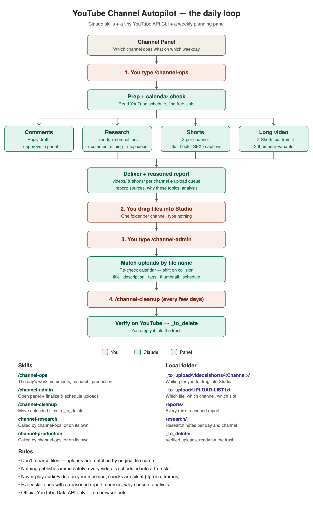
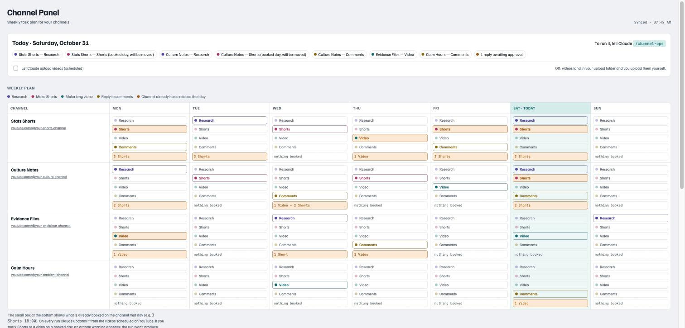

# I Run Four YouTube Channels With One Command. Here's the System.

*How I turned research, Shorts, long videos, comment replies and scheduling into a set of Claude skills — and got my own job down to "drag files into Studio".*



---

I'm a software developer with a day job. On the side I run four faceless YouTube channels: a stats Shorts channel, a pop-culture channel, an evidence-style explainer channel and an ambient-sounds channel. Every one of them needs the same boring loop, every week:

1. Find out what's working in the niche right now.
2. Turn that into Shorts and long videos — script, voice, footage, captions, music, thumbnail.
3. Upload, write titles, descriptions and tags, and schedule into a free slot.
4. Reply to comments.
5. Clean up the files.

Four channels × that loop = no life. So I sat down with Claude and built a system where **I type one command in the morning, drag a few folders into YouTube Studio, and type a second command**. Everything else is automated — and every run ends with a report that explains *why* it did what it did.

This post walks through the design. All the code and skills are open source: **[github.com/yt17/youtube-channel-autopilot](https://github.com/yt17/youtube-channel-autopilot)**.

## The three pieces

**1. A planning panel.** A small web page (a Claude Artifact with a built-in database) where each row is a channel and each column a weekday. I click chips — *Research*, *Shorts*, *Video*, *Comments* — to decide what happens on which day. Under each cell there's a box showing what's *already booked* on YouTube that day, refreshed on every run, so I never stack two long videos on the same evening.



The panel also holds the comment reply drafts waiting for my approval, the upload queue, the list of competitors being tracked, and a log of recent runs.

**2. Five skills.** A *skill* is a folder with a `SKILL.md` that tells Claude how to do one kind of job. I split the work into five:

| Skill | What it does |
|---|---|
| `/channel-ops` | The manager. Reads today's plan, checks each channel's calendar, launches up to four agents **in parallel** (comments, research, Shorts, long video), delivers the files and writes the run report. |
| `channel-research` | Competitor outliers, niche trends, comment mining, your own channel's winners and losers → 8–10 ideas, top 3 starred. |
| `channel-production` | 10 title candidates → 1, 3 thumbnail variants, 3 hooks → 1, retention-shaped script, neural voice, cue-sheet SFX, word-by-word captions, SEO package, and two Shorts cut from every long video. |
| `/channel-admin` | Opens the panel and finalizes whatever I just uploaded: title, description, tags, thumbnail, schedule. |
| `/channel-cleanup` | Verifies on YouTube that each upload really exists and is scheduled, then moves the local files to `_to_delete/`. |

Early on I had one giant skill. Splitting it paid off immediately: research and production can be run on their own, the manager stays short, and each skill's instructions are focused enough that the output quality went up.

**3. A tiny YouTube CLI.** `ytool.py` is ~400 lines of Python over the **official YouTube Data API v3** — no browser bots, nothing that could get a channel flagged. It handles OAuth per channel, unanswered comments, replies, the publishing calendar, competitor videos, trend search, a video's top comments, "pending" uploads, finalizing metadata + schedule, and resumable uploads.

## A day in the loop

**Morning: `/channel-ops`.** Claude reads the panel, sees that today is, say, *Research* for two channels, *Shorts* for one and *Long video* for another. Before anything else it pulls each channel's YouTube calendar and works out free slots from the channel's own habits (if a channel always posts Shorts at 12:00, 17:00 and 21:00, new Shorts go into the next free one of those). Then it starts the agents in parallel.

When they finish, files land in one folder per channel — `_to_upload/shorts/<Channel>/` — so I can bulk-drag a whole folder into that channel's Studio. Each video also gets a record in the panel's upload queue with its title, description, tags, thumbnail and planned slot.

**Midday: drag.** I open Studio, drop the folder in, and close the dialog without typing anything. The videos sit there as private drafts.

**Afterwards: `/channel-admin`.** This is the trick that makes the whole thing work without fighting the API: YouTube keeps the **original file name** of every upload (`fileDetails.fileName`). So the skill lists my unscheduled private uploads, matches each one to its queue record *by file name*, and fills in everything. I never touch a title field.

Why not just upload through the API? Uploads from an **unaudited** Google Cloud project can be locked to private by YouTube. Dragging files into Studio myself takes ten seconds and avoids the problem; the API only *edits* videos that are already there. (If you have an audited project, flip "Let Claude upload videos" in the panel and step 2 disappears.)

**Every few days: `/channel-cleanup`.** It checks each finished upload on YouTube (exists, processed, scheduled or public) before moving the local files to `_to_delete/`. It never deletes anything itself — I empty that folder.

## The details that mattered

**Re-check the calendar at the last second.** The slot chosen in the morning can be taken by the time I upload — I might have scheduled something by hand in between. So `finalize` re-reads the channel's whole schedule right before it sets `publishAt`. If the exact minute is taken, or the time has already passed, it moves the video to the same time on the next free day and reports why:

```python
first = w
while w.astimezone(dt.timezone.utc).replace(second=0, microsecond=0) in taken:
    w += dt.timedelta(days=1)
if w != first:
    reasons.append("slot already taken in calendar")
```

Nothing is ever published immediately. Every video is `private` + `publishAt`.

**Reports with reasons, not just results.** The first version reported "3 Shorts produced". That's useless when you want to know whether to trust it. Now every skill must end with a structured report. Research has to say which competitors it scanned and *why those*, which videos broke out (views/day and how many × the channel average), what viewers keep asking in the comments, why each starred idea was chosen, and every source with a date. Production has to show the top three title candidates with their scores, the claim → source table, which voice was used and how it differs from today's other videos, and the loudness and frame checks. The reports go into the chat, a `reports/` folder and the panel.

**Outliers over averages.** Research doesn't look at what's popular; it looks at what beat *its own channel's* average by more than 2× in the last week. That's a much stronger signal for a small channel, and it's cheap: the whole research run fits in about 1,200 of the 10,000 daily API quota units.

**Mine the comments.** The best ideas came from the comment sections of competitors' outlier videos: "do one on…", "why didn't you mention…", "part 2?". The research skill pulls the top comments of the top three outliers and turns the gaps into ideas.

**No slideshows.** The production skill has hard rules: real moving stock footage with reuse-friendly licences, frequent cuts, different voice and caption style for every video made on the same day, no copyrighted music or clips, and full packaging before upload.

**Silent checks.** One night a preview started playing out loud on my laptop. Now the rule is in every skill: never play audio or video on my machine. Claude checks with `ffprobe`, loudness analysis and frames pulled from the start, middle and end.

**Comment replies with a human in the loop.** The comments agent drafts short replies in each channel's voice and skips spam. Drafts wait in the panel until I hit *Approve* — or I can flip "send without approval".

## What's in the repo

```
skills/
  channel-ops/SKILL.md          manager: plan → calendar → 4 parallel agents → deliver → report
  channel-research/SKILL.md     competitors, outliers, trends, comment mining, ideas, report
  channel-production/SKILL.md   titles, thumbnails, hook, script, voice, SFX, captions, SEO, cuts
  channel-admin/SKILL.md        open panel + finalize uploads by file name
  channel-cleanup/SKILL.md      verify on YouTube → _to_delete
tools/ytool.py                  YouTube Data API v3 CLI (official API only)
panel/panel.html                the planning panel (Claude Artifact with a database)
config/config.example.json      your channels, niches and rules
docs/                           diagrams and screenshots
```

## Try it with your own channels

1. **Google Cloud:** enable *YouTube Data API v3*, create an OAuth consent screen (External, add yourself as a test user) and an OAuth client of type **Desktop app**. Save the JSON as `$YT_HOME/client_secret.json`.
2. **Authorize each channel:**
   ```bash
   export YT_HOME=~/youtube/_system
   python3 tools/ytool.py auth-url my-channel      # open the link, pick the channel
   python3 tools/ytool.py auth-code my-channel "http://localhost:8765/?code=..."
   python3 tools/ytool.py calendar my-channel
   ```
3. **Describe your channels** in `$YT_HOME/config.json` (copy `config/config.example.json`): slug, name, channel ID, niche, YouTube category and the rules you want every video to follow.
4. **Publish the panel:** ask Claude to publish `panel/panel.html` as an Artifact with the database capability, add one `channels/<slug>` document per channel, and put its URL into `panel_url`.
5. **Add the skills** from `skills/` to Claude and type `/channel-ops`.

Never commit `client_secret.json` or `tokens/` — the `.gitignore` already excludes them.

## What I'd tell you before you build your own

- **Split the work by responsibility.** One manager plus focused workers beats one skill that knows everything.
- **Make the human step tiny instead of zero.** Dragging a folder is ten seconds and sidesteps the hardest part of the API.
- **Ask for reasons.** A report that explains its choices is the difference between automation you check and automation you trust.
- **Respect the platform.** Official API, scheduled publishing, no bots, licensed footage. The channels are the asset; don't risk them for a shortcut.

The whole system came together over a few long sessions with Claude. Now my weekday YouTube time is one command, one drag and one more command.

*Code, skills and panel: [github.com/yt17/youtube-channel-autopilot](https://github.com/yt17/youtube-channel-autopilot) — MIT licensed.*
